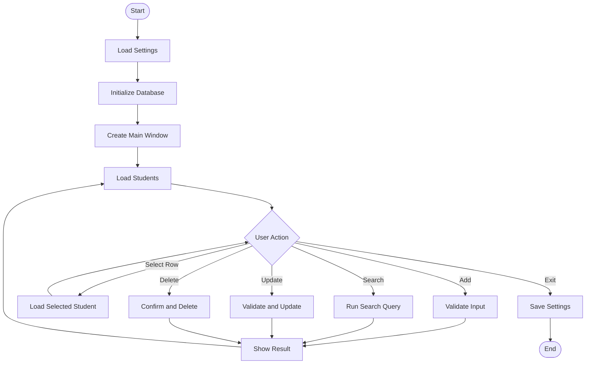

# جلسه ۱۸ — طراحی پروژه نهایی مدیریت دانشجو

## هدف جلسه

در این جلسه، به‌جای افزودن یک قابلیت کوچک دیگر، آموخته‌های جلسات قبل را در قالب یک پروژه منسجم سازمان‌دهی می‌کنیم. هدف این است که پیش از نوشتن کدهای متعدد، مسئله را تحلیل کنیم، نیازمندی‌ها را مشخص کنیم، رابط کاربری را طراحی کنیم و مسئولیت فایل‌های مختلف را جدا نگه داریم.

پروژه نهایی ما یک **برنامه مدیریت دانشجو** است که اطلاعات را در SQLite ذخیره می‌کند و رابط گرافیکی آن با Tkinter ساخته می‌شود.

در پایان جلسه، دانشجو می‌تواند:

- نیازمندی‌های اصلی و فرعی پروژه را بنویسد.
- اجزای رابط کاربری را بر اساس وظیفه گروه‌بندی کند.
- مسئولیت فایل‌های برنامه را از هم جدا کند.
- جریان کار اصلی برنامه را ترسیم کند.
- برای پروژه، برنامه آزمون و مراحل پیاده‌سازی داشته باشد.

## ۱. تعریف مسئله

یک آموزشگاه می‌خواهد اطلاعات دانشجویان خود را در برنامه‌ای ساده ثبت و مدیریت کند. مسئول آموزش باید بتواند دانشجو را اضافه کند، اطلاعات او را تغییر دهد، رکوردی را حذف کند و بین دانشجویان جست‌وجو انجام دهد.

### اطلاعات هر دانشجو

| فیلد | نوع پیشنهادی | توضیح |
|---|---|---|
| `id` | `INTEGER` | شناسه یکتای خودکار |
| `full_name` | `TEXT` | نام و نام خانوادگی |
| `student_code` | `TEXT` | کد دانشجویی یکتا |
| `phone` | `TEXT` | شماره تماس |
| `course` | `TEXT` | نام دوره |
| `created_at` | `TEXT` | زمان ثبت رکورد |

نکته: شماره تماس را به‌صورت `TEXT` نگه می‌داریم، نه عدد؛ چون ممکن است با صفر شروع شود و قرار نیست روی آن محاسبات ریاضی انجام دهیم.

## ۲. نیازمندی‌های پروژه

### ۲.۱. نیازمندی‌های عملکردی

- **FR-01:** برنامه بتواند دانشجوی جدید ثبت کند.
- **FR-02:** برنامه بتواند همه دانشجویان را در جدول نمایش دهد.
- **FR-03:** کاربر بتواند یک ردیف را انتخاب کند و اطلاعات آن را در فرم ببیند.
- **FR-04:** کاربر بتواند اطلاعات دانشجوی انتخاب‌شده را ویرایش کند.
- **FR-05:** کاربر بتواند رکورد انتخاب‌شده را پس از تأیید حذف کند.
- **FR-06:** کاربر بتواند بر اساس نام یا کد دانشجویی جست‌وجو کند.
- **FR-07:** ورودی‌های ضروری قبل از ذخیره اعتبارسنجی شوند.
- **FR-08:** خطاهای پایگاه داده به‌شکل کنترل‌شده مدیریت شوند.
- **FR-09:** تنظیمات ساده برنامه در فایل JSON ذخیره شوند.
- **FR-10:** هنگام بستن برنامه، منابع لازم به‌شکل مناسب مدیریت شوند.

### ۲.۲. نیازمندی‌های غیرعملکردی

- رابط کاربری باید ساده و قابل فهم باشد.
- عملیات پایگاه داده باید از کد رابط کاربری جدا باشد.
- کوئری‌ها باید با پارامترها اجرا شوند؛ ورودی کاربر نباید با اتصال رشته‌ای وارد SQL شود.
- نام‌گذاری متغیرها، توابع و فایل‌ها باید روشن و یکدست باشد.
- برنامه در صورت خالی بودن پایگاه داده نیز باید درست اجرا شود.
- خطاها نباید باعث بسته‌شدن ناگهانی برنامه شوند.

## ۳. طراحی رابط کاربری

پیشنهاد می‌کنیم پنجره اصلی را به سه بخش تقسیم کنیم:

1. **بخش فرم:** فیلدهای نام، کد دانشجویی، شماره تماس و دوره.
2. **بخش عملیات:** دکمه‌های افزودن، ویرایش، حذف، پاک‌کردن فرم و تازه‌سازی.
3. **بخش جدول:** نمایش رکوردها با `ttk.Treeview` و امکان انتخاب ردیف.

در بالای جدول، یک ورودی جست‌وجو و دکمه جست‌وجو یا تازه‌سازی قرار می‌گیرد. پیام وضعیت نیز در پایین پنجره می‌تواند نتیجه عملیات را نمایش دهد.

### چیدمان مفهومی

```text
+----------------------------------------------------------+
| Student Management                                       |
+----------------------------------------------------------+
| Full Name: [________________]  Student Code: [________]  |
| Phone:     [________________]  Course:       [________]  |
| [Add] [Update] [Delete] [Clear Form] [Refresh]            |
+----------------------------------------------------------+
| Search: [________________________] [Search] [Show All]   |
+----------------------------------------------------------+
| ID | Full Name | Student Code | Phone | Course            |
|----|-----------|--------------|-------|------------------|
|    |           |              |       |                  |
|    |           |              |       |                  |
+----------------------------------------------------------+
| Status: Ready                                             |
+----------------------------------------------------------+
```

این طرح فقط نقشه اولیه است؛ لازم نیست در مرحله طراحی، همه جزئیات ظاهری را نهایی کنیم. مهم این است که وظیفه هر قسمت مشخص باشد.

## ۴. معماری چندفایلی

برای جلوگیری از تبدیل‌شدن برنامه به یک فایل بسیار طولانی، مسئولیت‌ها را جدا می‌کنیم:

```text
student_manager/
├── main.py
├── database.py
├── ui.py
├── settings.py
├── settings.json
└── README.md
```

### مسئولیت هر فایل

| فایل | مسئولیت |
|---|---|
| `main.py` | ساخت پنجره اصلی و اجرای برنامه |
| `database.py` | ایجاد جدول و عملیات SQL |
| `ui.py` | ساخت ویجت‌ها و مدیریت تعامل کاربر |
| `settings.py` | بارگذاری، اعتبارسنجی و ذخیره تنظیمات |
| `settings.json` | نگهداری ترجیحات ساده برنامه |
| `README.md` | راهنمای اجرا و استفاده از برنامه |

در این طراحی، `ui.py` نباید خودش منطق ساخت جدول پایگاه داده یا جزئیات SQL را مدیریت کند. بهتر است برای این کار توابع مشخصی را از `database.py` فراخوانی کند.

## ۵. طراحی پایگاه داده

ساختار اولیه جدول:

```sql
CREATE TABLE IF NOT EXISTS students (
    id INTEGER PRIMARY KEY AUTOINCREMENT,
    full_name TEXT NOT NULL,
    student_code TEXT NOT NULL UNIQUE,
    phone TEXT NOT NULL,
    course TEXT NOT NULL,
    created_at TEXT NOT NULL DEFAULT CURRENT_TIMESTAMP
);
```

نکته‌های مهم:

- `PRIMARY KEY` هر رکورد را به‌شکل یکتا شناسایی می‌کند.
- `AUTOINCREMENT` باعث می‌شود شناسه به‌طور خودکار تولید شود.
- `NOT NULL` خالی‌بودن مقدار را در سطح پایگاه داده محدود می‌کند.
- `UNIQUE` از تکرار کد دانشجویی جلوگیری می‌کند.
- اعتبارسنجی در رابط کاربری همچنان لازم است؛ محدودیت پایگاه داده جای پیام مناسب به کاربر را نمی‌گیرد.

## ۶. جریان کار برنامه

### ثبت دانشجو

1. کاربر فیلدها را پر می‌کند.
2. برنامه ورودی‌ها را اعتبارسنجی می‌کند.
3. رابط کاربری تابع ثبت در `database.py` را فراخوانی می‌کند.
4. پایگاه داده رکورد را ذخیره می‌کند.
5. جدول دوباره بارگذاری می‌شود.
6. پیام موفقیت یا خطا نمایش داده می‌شود.

### ویرایش دانشجو

1. کاربر ردیفی از جدول را انتخاب می‌کند.
2. برنامه اطلاعات رکورد را در فرم قرار می‌دهد.
3. کاربر تغییرات را وارد می‌کند.
4. برنامه ورودی‌ها را اعتبارسنجی می‌کند.
5. دستور `UPDATE` با شرط `WHERE id = ?` اجرا می‌شود.
6. جدول تازه‌سازی و نتیجه به کاربر اعلام می‌شود.

### حذف دانشجو

1. کاربر ردیف موردنظر را انتخاب می‌کند.
2. برنامه شناسه همان رکورد را مشخص می‌کند.
3. پیام تأیید نمایش داده می‌شود.
4. در صورت تأیید، دستور `DELETE` با پارامتر اجرا می‌شود.
5. جدول تازه‌سازی می‌شود.

### جست‌وجو

1. کاربر نام یا کد را وارد می‌کند.
2. برنامه تابع جست‌وجو را فراخوانی می‌کند.
3. SQL با `WHERE` و در صورت نیاز `LIKE` اجرا می‌شود.
4. فقط نتیجه‌های منطبق در جدول نمایش داده می‌شوند.

## ۷. نمودار جریان ساده



این نمودار برای توضیح جریان کلی است. در پیاده‌سازی واقعی، هر عملیات ممکن است در صورت خطا به مسیر نمایش پیام خطا برود و سپس کنترل به رابط کاربری بازگردد.

## ۸. تقسیم پروژه به مرحله‌های کوچک

پروژه را یک‌باره نمی‌نویسیم. هر مرحله باید قابل اجرا و آزمایش باشد.

| مرحله | خروجی مورد انتظار |
|---|---|
| ۱ | ایجاد پوشه پروژه و فایل‌ها |
| ۲ | ساخت و آزمایش توابع پایگاه داده |
| ۳ | ساخت پنجره و فرم ورودی |
| ۴ | نمایش رکوردها در `Treeview` |
| ۵ | افزودن رکورد جدید |
| ۶ | انتخاب رکورد و پرکردن فرم |
| ۷ | ویرایش و حذف |
| ۸ | جست‌وجو و نمایش همه رکوردها |
| ۹ | اعتبارسنجی و مدیریت خطا |
| ۱۰ | ذخیره تنظیمات و بهبود تجربه کاربری |
| ۱۱ | آزمون نهایی و نوشتن راهنمای استفاده |

## ۹. برنامه آزمون پروژه

پیش از تحویل، موارد زیر را آزمایش کنید:

| شماره | آزمایش | نتیجه مورد انتظار |
|---|---|---|
| ۱ | اجرای برنامه برای اولین بار | پایگاه داده و جدول ساخته شوند |
| ۲ | ثبت فرم خالی | پیام اعتبارسنجی نمایش داده شود |
| ۳ | ثبت دانشجوی معتبر | رکورد در جدول دیده شود |
| ۴ | ثبت کد دانشجویی تکراری | خطا مدیریت شود و برنامه باز بماند |
| ۵ | انتخاب یک ردیف | اطلاعات در فرم نمایش داده شوند |
| ۶ | ویرایش رکورد | فقط رکورد موردنظر تغییر کند |
| ۷ | حذف و لغو تأیید | با لغو، رکورد باقی بماند |
| ۸ | حذف و تأیید | رکورد حذف شود |
| ۹ | جست‌وجوی عبارت موجود | نتیجه‌های مرتبط نمایش داده شوند |
| ۱۰ | جست‌وجوی عبارت ناموجود | پیام مناسب یا جدول خالی نمایش داده شود |
| ۱۱ | بستن و اجرای دوباره برنامه | داده‌های SQLite باقی بمانند |
| ۱۲ | تغییر تنظیمات و اجرای دوباره | تنظیمات ذخیره‌شده بازیابی شوند |

## ۱۰. اصول مهمی که باید در پروژه رعایت شوند

### استفاده از پارامترهای SQL

روش مناسب:

```python
cursor.execute(
    "SELECT * FROM students WHERE student_code = ?",
    (student_code,)
)
```

روش نامناسب:

```python
query = "SELECT * FROM students WHERE student_code = '" + student_code + "'"
cursor.execute(query)
```

روش اول امن‌تر و قابل‌اعتمادتر است و از اتصال مستقیم ورودی کاربر به متن SQL جلوگیری می‌کند.

### جداسازی رابط و پایگاه داده

کد رابط کاربری باید بگوید چه عملی لازم است؛ کد پایگاه داده باید مسئول اجرای عملیات SQL باشد. این جداسازی آزمایش، نگهداری و توسعه برنامه را ساده‌تر می‌کند.

### نگهداری شناسه واقعی رکورد

برای ویرایش و حذف، از شناسه `id` رکورد انتخاب‌شده استفاده کنید؛ شماره ردیف قابل مشاهده در جدول لزوماً شناسه پایگاه داده نیست.

## ۱۱. تمرین‌های جلسه

### تمرین ۱

سه نیازمندی عملکردی دیگر برای برنامه مدیریت دانشجو بنویسید.

**پاسخ نمونه:**

- امکان پاک‌کردن همه فیلدهای فرم با دکمه جداگانه.
- نمایش تعداد رکوردهای پیدا‌شده پس از جست‌وجو.
- جلوگیری از اجرای ویرایش یا حذف وقتی هیچ ردیفی انتخاب نشده است.

### تمرین ۲

چرا `student_code` را یکتا تعریف می‌کنیم؟

**پاسخ:** چون در این پروژه کد دانشجویی باید هر دانشجو را از دیگران متمایز کند. قید `UNIQUE` از ذخیره کد تکراری در پایگاه داده جلوگیری می‌کند.

### تمرین ۳

چرا عملیات SQL را در `ui.py` نمی‌نویسیم؟

**پاسخ:** برای جداسازی مسئولیت‌ها. رابط کاربری به نمایش و تعامل می‌پردازد و ماژول پایگاه داده به ذخیره و بازیابی اطلاعات. این ساختار نگهداری و آزمون را ساده‌تر می‌کند.

### تمرین ۴

اگر کاربر هنگام حذف، پیام تأیید را لغو کند، برنامه باید چه کند؟

**پاسخ:** هیچ دستور `DELETE` اجرا نشود و رکورد بدون تغییر باقی بماند.

### تمرین ۵

برای آزمودن اینکه اطلاعات بعد از بسته‌شدن برنامه باقی می‌مانند، چه مراحلی لازم است؟

**پاسخ:** یک رکورد ثبت کنید، برنامه را ببندید، دوباره اجرا کنید و بررسی کنید همان رکورد از پایگاه داده خوانده شده باشد.

## ۱۲. تکلیف

1. پوشه پروژه را با ساختار پیشنهادی ایجاد کنید.
2. نیازمندی‌های عملکردی پروژه را در فایل `README.md` ثبت کنید.
3. طرح اولیه رابط کاربری را رسم کنید.
4. جدول پایگاه داده را با SQLite بسازید و دست‌کم توابع افزودن و دریافت همه رکوردها را جداگانه آزمایش کنید.
5. برای هر عملیات، دست‌کم یک حالت موفق و یک حالت خطا در برنامه آزمون بنویسید.

در این جلسه هنوز لازم نیست کل برنامه نهایی تکمیل شود. هدف، ساختن نقشه‌ای روشن برای پیاده‌سازی مرحله‌ای است.

## ۱۳. چک‌لیست مدرس

- [ ] مسئله پروژه و کاربران آن مشخص شد.
- [ ] فیلدهای دانشجو تعریف شدند.
- [ ] نیازمندی‌های عملکردی و غیرعملکردی نوشته شدند.
- [ ] طرح اولیه پنجره تهیه شد.
- [ ] مسئولیت فایل‌ها مشخص شد.
- [ ] جریان ثبت، ویرایش، حذف و جست‌وجو توضیح داده شد.
- [ ] موارد آزمون پروژه تعیین شدند.
- [ ] استفاده از پارامترهای SQL و شناسه واقعی رکورد مرور شد.

## جلسه بعد

در جلسه ۱۹، پیاده‌سازی پروژه نهایی را به‌صورت مرحله‌ای آغاز می‌کنیم؛ ابتدا فایل `database.py`، ایجاد جدول و توابع مستقل پایگاه داده را می‌سازیم و بدون رابط گرافیکی آزمایش می‌کنیم.
